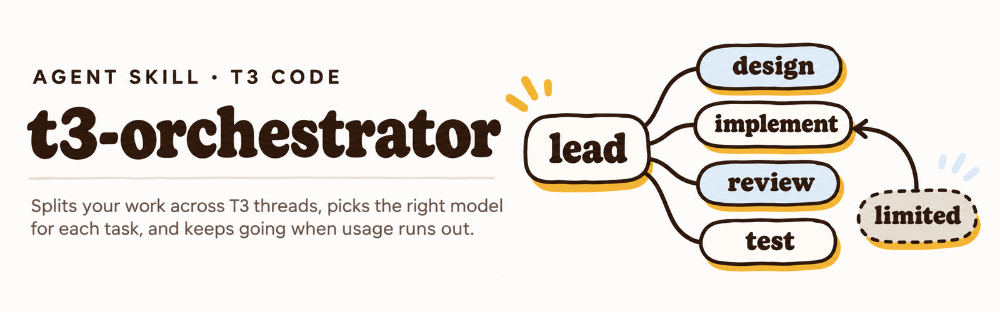
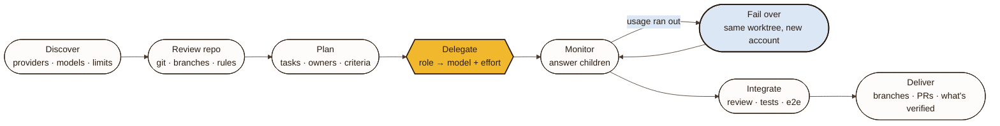
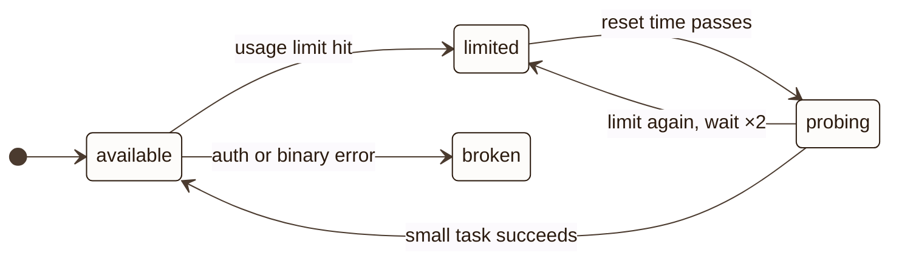

<p align="center">
  <picture>
    <source media="(prefers-color-scheme: dark)" srcset="assets/banner-dark.png">
    
  </picture>
</p>

<p align="center">
  <a href="https://skills.sh"></a>
  
  
  <a href="LICENSE"></a>
</p>

<p align="center">
  <b>One lead thread. The right model for every task. No dead ends when an account runs dry.</b>
</p>

```bash
npx skills add wincrack07/t3-orchestrator
```

Then, in a [T3 Code](https://github.com/pingdotgg/t3code) thread: **"orchestrate what we discussed"**.

---

## ✦ What it does

|   |   |
|---|---|
| **Discovers your setup** | Reads your provider instances, models, and effort options from T3 (`orchestrator_capabilities`) instead of assuming a list. Skips anything disabled or signed out. |
| **Knows what each instance is for** | Subscriptions before pay-per-token API (API only with your OK). Prefers the account that matches the repo's owner. |
| **Routes by task** | Hard design and debugging get the strongest model at high effort. Clear features get a strong coder at medium. Research and tests get fast models at low. Reviews go to a *different* model family. |
| **Learns unfamiliar models** | When a name doesn't reveal the tier, it checks the provider's docs and saves a profile so the next run skips the lookup. |
| **Survives usage limits** | Detects an exhausted account, stops the stuck thread so auto-resume can't duplicate work, and continues the task on another account **in the same worktree**. |
| **Comes back when quota does** | After the reset time, it probes the account with a small task before trusting it again. |
| **Stays inside guardrails** | No merges, deploys, deletions, permission changes, or paid API use without you. Children inherit the same limits. |

## ✦ How a run flows



## ✦ Routing at a glance

| Role | Typical work | Model tier | Starting effort |
|---|---|---|---|
| `design` | architecture, migrations, security | most capable available | high → xhigh if critical |
| `implementation` (hard) | deep debugging, cross-module changes | most capable or strong coder | high |
| `implementation` (clear) | well-specified feature | strong coder, mid-high tier | medium |
| `review` | PR or diff review | capable, **different family** | high |
| `research` | read code and docs, map, search | fast, large context | low → medium |
| `test` | write or run tests, mechanical fixes | fast or mid tier | low → medium |
| `general` | docs, renames, trivial edits | fastest or cheapest | low |

It escalates only after a failed attempt: **effort first, then model.** The full method lives in [`references/model-routing.md`](references/model-routing.md).

## ✦ When an account runs out



1. **Record** the account and its reset time in a machine-wide ledger (`~/.local/state/t3-orchestrator/providers.json`).
2. **Stop** the limited thread, so T3's auto-resume can't redo the work later.
3. **Salvage** the progress from the child's worktree (`git status`, `diff`, `log`).
4. **Continue** on the next-best account in the **same worktree**, with a handoff that says what's done and what's left.
5. **Tell you** in one line: *"Codex · Personal ran out (5 h, back at 18:40). Moved T3 to Claude · Personal, same worktree."*

The orchestrator checkpoints its own run file after every step, so a successor thread, or the same thread after a model switch, picks up exactly where it stopped. Details in [`references/usage-limits.md`](references/usage-limits.md).

## ✦ Install

<table>
<tr><td><b>skills CLI</b></td><td>

```bash
npx skills add wincrack07/t3-orchestrator
```

</td></tr>
<tr><td><b>Manual</b></td><td>

Copy this folder into your agent's skills directory: `~/.claude/skills/t3-orchestrator`, `~/.codex/skills/t3-orchestrator`, or your OpenCode skills folder.

</td></tr>
</table>

**Try it with prompts like:**

> *"Orchestrate everything we just discussed."*
> *"Use the t3-orchestrator skill on this list: …"*
> *"Split this refactor across T3 threads and review it with another model."*

<details>
<summary><b>Requirements</b></summary>

- T3 Code with the orchestrator MCP tools: `orchestrator_capabilities`, `delegate_task`, `task_status`, `task_cancel`, `t3_thread_launch`, `t3_thread_read`, `t3_thread_wait`. If they're missing, it falls back to the `t3 thread` CLI.
- At least one provider instance in **Settings → Providers**. Failover shines with two or more accounts or providers.

</details>

<details>
<summary><b>Notes and limitations</b></summary>

- Written against T3 Code's documentation and CLI as of v0.1.8 (November 2026). T3 moves fast, so the skill checks `t3 --version` and what the tools report, and adapts.
- T3's MCP tools don't expose a "limited" state or reset time directly, so exhaustion is detected from the thread's activity. New provider wording may need a new pattern in `references/usage-limits.md`.
- An orchestrator can't switch its *own* thread's provider through tools. Only T3's model picker can, between accounts that share a config folder. The skill hands off to a successor thread instead.
- State lives in `~/.local/state/t3-orchestrator/` and never includes credentials.

</details>

<details>
<summary><b>Files</b></summary>

```text
t3-orchestrator/
├── SKILL.md                    the orchestration workflow
└── references/
    ├── model-routing.md        instance, model, and effort selection
    └── usage-limits.md         detection, failover, and recovery
```

</details>

---

<p align="center">
  <a href="https://juliosaldana.com"></a><br>
  <sub>Made by <a href="https://juliosaldana.com"><b>Julio Saldaña</b></a> · <a href="LICENSE">MIT</a></sub>
</p>
